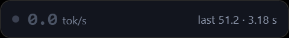

# DeepAI Code TPS

Счётчик скорости генерации токенов для [DeepAI Code](https://deepai.code) на
**macOS и Windows**. На macOS это приложение в строке меню: значок со спидометром
и живой **tok/s**, по клику — панель с TTFT, средней скоростью и последними
ответами. На Windows — компактная строка 240×32 поверх всех окон: живой tok/s,
средняя скорость и TTFT в одну линию. В обоих случаях есть локальный дашборд с
журналом последних ответов.

Токены считаются по потоку чанков внутри движка **dsh** — модели подключены
напрямую, `models.json` не меняется, прокси нет.



## Возможности

- macOS: приложение в menu bar (без иконки в Dock) — значок и tok/s всегда на
  виду; клик открывает панель, повторный клик, клик мимо или Esc закрывает её;
- в панели: TTFT, средняя скорость, число токенов и до четырёх последних
  ответов; высота подстраивается под содержимое;
- ПКМ по значку — короткое меню с дашбордом и выходом;
- панель открывается поверх полноэкранных приложений, **не активируя счётчик**:
  фокус остаётся у прежнего приложения, поэтому строка меню не залипает;
- Windows: компактная строка поверх всех окон, перетаскивается мышью, двойной
  клик — закрыть; в простое показывает последний замер, позиция запоминается и
  не уезжает за край экрана;
- Windows: автозапуск при входе в систему (без окна консоли) и ярлык
  «DeepAI TPS» в меню «Пуск»;
- дашборд `http://127.0.0.1:57451/__tps/` с журналом последних 40 ответов
  (точные `input`/`output` из usage API);
- работает в новых чатах DeepAI Code (движок dsh, 0.3.x) и в старых pi-чатах;
- ноль изменений в конфигурации моделей и провайдера.

## Требования

- macOS 13+ (приложение — AppKit/SwiftUI; нужен `swiftc` из Xcode Command
  Line Tools: `xcode-select --install`) **или** Windows 10/11 (окно — WPF,
  PowerShell 5.1+);
- Node.js 18+ в `PATH` (нужен хабу);
- DeepAI Code 0.3.x.

## Установка

### macOS

```bash
git clone https://github.com/michael-korotaev/deepai-code-tps.git ~/AI/deepai-code-tps
cd ~/AI/deepai-code-tps
./install.sh
```

`install.sh` делает три вещи и сразу запускает счётчик:

1. кладёт dsh-плагин в `~/.deepai-code/userdata/deepai/dsh/tps-push.mjs`
   и включает его через машинный слой `cordis.patch.yml` в той же папке;
2. кладёт pi-расширение в `<agent-dir>/extensions/tps-push.js` (для старых чатов);
3. собирает `macos/dist/TPS Counter.app` (`swiftc`, ad-hoc подпись) и
   запускает приложение: оно само поднимает хаб метрик и садится в строку меню.

Цифры появятся **в новом чате**: плагин читается движком при старте чата.
Чат, начатый до установки, метрик не даёт.

Автозапуска по умолчанию нет. Включить LaunchAgent на вход в систему:

```bash
./install.sh --with-agent
```

Ключи: `--port 57451`, `--no-start` (только установка), `--quiet`.

### Windows

```powershell
git clone https://github.com/michael-korotaev/deepai-code-tps.git C:\AI\deepai-code-tps
cd C:\AI\deepai-code-tps
powershell -ExecutionPolicy Bypass -File .\install.ps1
```

`install.ps1` делает пять вещей и сразу запускает счётчик:

1. кладёт dsh-плагин в `%USERPROFILE%\.deepai-code\userdata\deepai\dsh\tps-push.mjs`
   и включает его через машинный слой `cordis.patch.yml` в той же папке;
2. кладёт pi-расширение в `<agent-dir>\extensions\tps-push.js` (для старых чатов);
3. регистрирует задачу Планировщика «DeepAI TPS Overlay» на вход в систему
   (тихий запуск через `autostart.vbs`, без вспышки консоли);
4. создаёт ярлык «DeepAI TPS» в меню «Пуск»;
5. поднимает хаб метрик и окно.

Ключи: `-NoTask` — не трогать автозапуск, `-NoShortcut` — не создавать ярлык,
`-NoStart` — только установить, без запуска.

## Каждый день

```bash
# macOS
./start.sh     # включить (приложение в menu bar + хаб)
./stop.sh      # выключить
```

```cmd
:: Windows
start.cmd     :: включить (хаб + окно)
stop.cmd      :: выключить
```

Все команды идемпотентны: повторный запуск ничего не дублирует. Окно Windows
помнит позицию и при старте прижимается к краю экрана, если разрешение изменилось.

Закрыть приложение можно тремя способами: кнопка «Выход» в панели, пункт
«Выход» в меню по правому клику на значке или `./stop.sh` из терминала
(⌘Q работает, пока открыта панель). Приложение гасит и свой хаб.

Дашборд: <http://127.0.0.1:57451/__tps/>

## Автозапуск и меню «Пуск» (Windows)

Задача Планировщика запускает `autostart.vbs` при входе в систему; тот
запускает `start.ps1` со скрытым окном, поэтому консоль не мигает.

Выключить автозапуск:

```powershell
Unregister-ScheduledTask -TaskName 'DeepAI TPS Overlay' -Confirm:$false
```

Ярлык лежит в `%APPDATA%\Microsoft\Windows\Start Menu\Programs\DeepAI TPS.lnk`.
Windows не разрешает закреплять ярлыки на «Начальном экране» программно
(shell-команда «Закрепить в меню "Пуск"» возвращает `E_ACCESSDENIED`), поэтому
закрепление — один правый клик: «Пуск» → «DeepAI TPS» → «Закрепить в меню "Пуск"».

## Как это работает

```
 dsh (движок DeepAI Code)
   └─ плагин tps-push: оборачивает llm/stream, считает прирост символов
        └─ POST /__ingest → tps-hub.mjs (127.0.0.1:57451)
             ├─ GET /__tps/state → приложение в menu bar (Swift, каждые 150 мс)
             │                      или окно WPF на Windows
             └─ GET /__tps/       → HTML-дашборд
```

tok/s — оценка по символам: латиница ~3.8 симв./токен, кириллица и CJK
~1.6 симв./токен, окно усреднения 1.2 с. Точные значения токенов приходят из
`usage` в конце ответа и видны в журнале дашборда.

## Важно: почему плагин в «машинном слое»

Приложение при каждом старте удаляет всю папку `$DSH_HOME/profiles` и
создаёт её заново, поэтому плагин, положенный в `profiles/acp`,
исчезает при следующем запуске. Плагин живёт в домашней папке dsh, а
подключается через машинный слой `$DSH_HOME/cordis.patch.yml`:

```yaml
- insert:
    - id: tps-push
      name: ./tps-push.mjs
```

Порядок слоёв dsh: бандлы профиля → `profiles/<name>/cordis.patch.yml` →
`$DSH_HOME/cordis.patch.yml` → `--patch` приложения. Приложение этот
файл не трогает, поэтому счётчик переживает перезапуски.

Если в `cordis.patch.yml` уже есть `- insert:` (например, MCP-серверы),
установщик macOS дописывает запись **в конец существующего блока**: второй
`- insert:` перекрыл бы первый. Перед правкой файл сохраняется рядом как
`cordis.patch.yml.bak-<дата>`.

## Диагностика

Значок «—» красного цвета — приложение не видит хаб; серый `0` — всё в
порядке, просто нет генерации.

Если строка меню перестала скрываться в полноэкранных приложениях, проверьте,
не осталось ли активным приложение-аксессуар без окон: `lsappinfo front`.
Счётчик панель не активирует (`NSPanel` с `.nonactivatingPanel`), а если
приложение активировали через `open -a`, оно сразу возвращает фокус.

На macOS 27.2 бывает системный сбой: строка меню не скрывается в полноэкранном
режиме даже при полностью закрытом счётчике — это воспроизводится минимальным
тестовым приложением. Перезапуск SystemUIServer и Dock в этом состоянии не
помогает, нужен выход из системы или перезагрузка.

Проверить саму настройку: `defaults read NSGlobalDomain
AppleMenuBarVisibleInFullscreen` — `0` значит «скрывать в полноэкранном
режиме», `1` — «показывать всегда».

1. Проверьте, что приложение и хаб запущены: `./start.sh` (macOS) или `start.cmd`.
2. Откройте новый чат и отправьте сообщение: значок начнёт показывать tok/s.
3. Посмотрите состояние: <http://127.0.0.1:57451/__tps/state> — при генерации
   `lastIngest` обновляется, `active` становится `true`.
4. Логи macOS: `~/Library/Application Support/TPS Counter/logs/` (`hub.log`,
   `hub.log.err`; `app.log` — если приложение не смогло запустить хаб).
   При запуске через `start.sh --no-app` логи лежат в `logs/` репозитория.

Проверить, что движок видит плагин (macOS):

```bash
"/Applications/DeepAI Code.app/Contents/Frameworks/DeepAI Code Helper.app/Contents/MacOS/DeepAI Code Helper" \
  "/Applications/DeepAI Code.app/Contents/Resources/app.asar/node_modules/@deepseek-ai/dsh/lib/bin.js" \
  --profile acp --patch ~/.deepai-code/userdata/deepai/dsh/deepai.patch.yml --dump-config \
  | grep -A1 tps-push
```

В выводе будет `name: file:///.../dsh/tps-push.mjs`.

Если после крупного обновления DeepAI Code счётчик замолчал — запустите
`install.sh` (macOS) или `install.ps1` ещё раз: он заново положит плагин и запись слоя.

## Удаление

```bash
./uninstall.sh          # macOS
```

```powershell
powershell -ExecutionPolicy Bypass -File .\uninstall.ps1   # Windows
```

Убирает dsh-плагин и запись слоя, pi-расширение, автозапуск (LaunchAgent или
задачу Планировщика), процессы, собранное приложение (`macos/dist`) и его логи
в `~/Library/Application Support/TPS Counter`. Модели при этом не затрагиваются.

## Структура репозитория

| Файл | Роль |
| --- | --- |
| `dsh/tps-push.mjs` | плагин движка dsh: слушает `llm/stream`, шлёт метрики в хаб |
| `extension/tps-push.js` | pi-расширение для старых чатов (тот же протокол) |
| `tps-hub.mjs` | приёмник метрик и дашборд, только loopback |
| `macos/TPSApp.swift` | приложение macOS: значок в menu bar и панель (SwiftUI) |
| `macos/Info.plist` | бандл `LSUIElement`, без иконки в Dock |
| `macos/build.sh` | сборка `macos/dist/TPS Counter.app` через `swiftc` |
| `overlay.ps1` | компактное окно-виджет Windows (WPF), опрашивает хаб |
| `autostart.vbs` | тихий запуск `start.ps1` для задачи Планировщика и ярлыка |
| `docs/overlay.png` | скриншот окна Windows для этого README |
| `install.sh` / `uninstall.sh` | установка и полный откат в macOS |
| `start.sh` / `stop.sh` | включение и выключение приложения в menu bar и хаба |
| `scripts/patch-yaml.mjs` | аккуратная правка машинного слоя dsh |
| `install.ps1` / `uninstall.ps1` | установка и полный откат в Windows |
| `start.ps1` / `stop.ps1` (+ `.cmd`) | включение и выключение хаба с окном в Windows |

## English

Live tokens-per-second meter for DeepAI Code on macOS and Windows. A dsh plugin
wraps the `llm/stream` hook, a local hub (127.0.0.1) aggregates the numbers, and
the UI displays them: on macOS a menu bar app (status item with tok/s, click for
a non-activating panel, SwiftUI/AppKit), on Windows a compact one-line always-on-top
WPF strip (drag to move, double-click to close) plus an HTML dashboard. The
Windows installer also registers a silent logon task and a Start-menu shortcut. Models stay connected directly; no proxy, no `models.json`
edits. Run `./install.sh` (macOS) or `install.ps1` (Windows), then open a new
chat.
